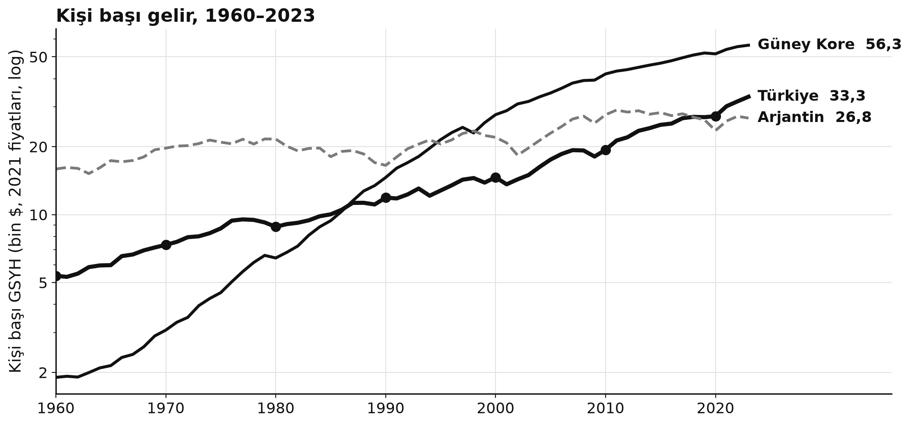
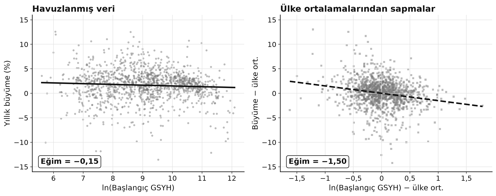
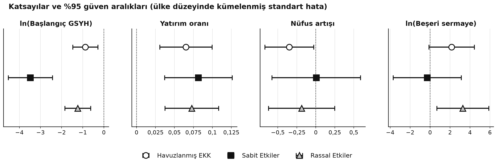
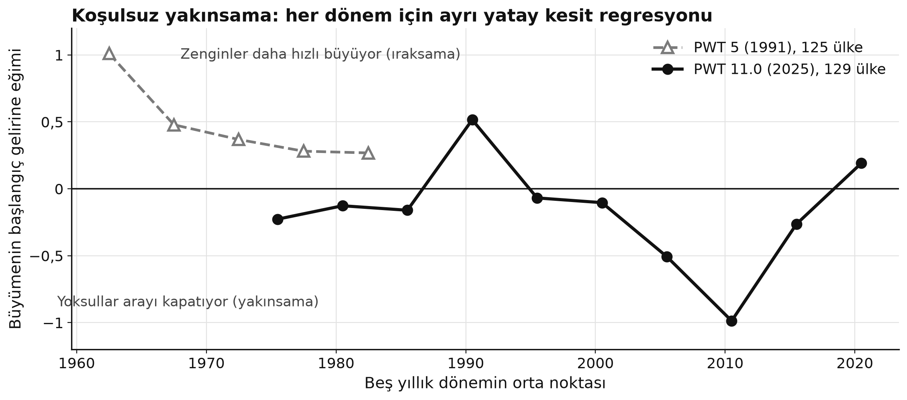
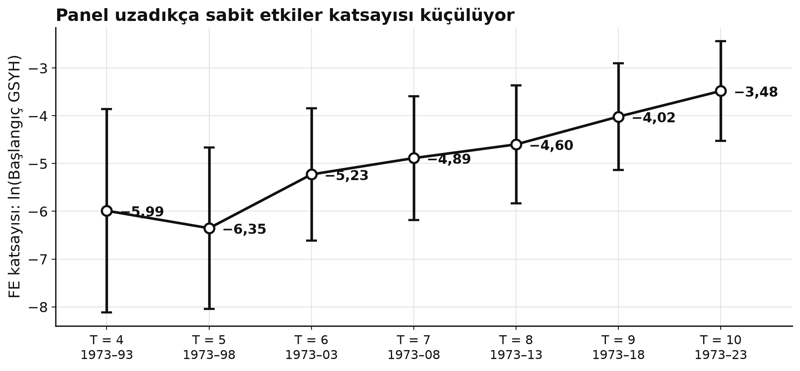
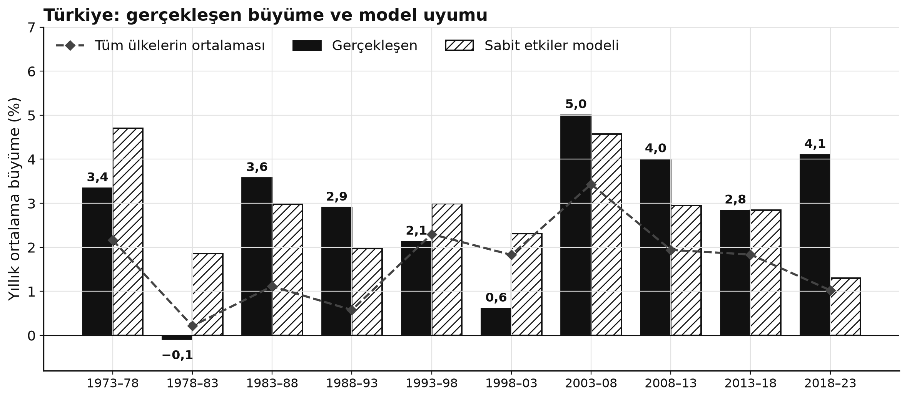

# Yoksul Ülkeler Arayı Kapatıyor mu? Panel Veriyle Büyüme ve Yakınsama, 1973–2023

129 ülkenin 50 yıllık büyüme verisi üzerinde koşullu yakınsama hipotezini test eden, uçtan uca tekrar üretilebilir bir panel veri analizi.

Ana veri Penn World Table 11.0'dır (Ekim 2025). Havuzlanmış EKK, sabit etkiler ve rassal etkiler modelleri tahmin edilir, model seçimi ve varsayım testleriyle sınanır. Aynı model 1991'de yayımlanan Penn World Table 5 verisiyle (1960–1985) yeniden tahmin edilerek eski ve yeni verinin anlattığı hikâye karşılaştırılır.

Ham veriden rapora kadar her adım koddur. Tablolar, grafikler, yazılı rapor ve sunum tek bir komutla yeniden üretilir; metinlerdeki hiçbir sayı elle yazılmamıştır.



*1973'te Türkiye'nin kişi başı geliri (8,0 bin dolar) Güney Kore'nin (3,9 bin dolar) iki katıydı. 2023'te Kore 56,3 bin dolar ile Türkiye'nin (33,3 bin dolar) 1,7 katına ulaştı. Değerler 2021 fiyatlarıyladır. Çalışmanın çıkış noktası bu ayrışmayı açıklayan sistematik bir yapı olup olmadığıdır.*

---

## Özet

| | |
|---|---|
| **Soru** | Başlangıç geliri düşük ülkeler daha hızlı büyüyor mu? Yatırım, nüfus artışı ve beşeri sermaye bu süreçte nasıl bir rol oynuyor? |
| **Veri** | PWT 11.0, 129 ülke × 10 beş yıllık dönem = 1.290 gözlem (dengeli panel) |
| **Yöntem** | Havuzlanmış EKK, sabit etkiler (FE), rassal etkiler (RE); ülke düzeyinde kümelenmiş standart hatalar |
| **Seçilen model** | Sabit etkiler (F, Breusch–Pagan, Hausman ve Mundlak testlerinin dördü de aynı yönde) |
| **Ana sonuç** | Koşullu yakınsama güçlü: yıllık hız %3,8, yarılanma süresi yaklaşık 18 yıl |

Kısa cevap şu: yoksul ülkeler zenginlerle **ortak bir düzeye** yakınsamıyor, ama her ülke **kendi denge düzeyine** hızla yakınsıyor. Bu iki ifade arasındaki fark, ülkeye özgü gözlenemeyen etkilerin modele alınıp alınmamasından kaynaklanıyor. Panel verinin bu soruda vazgeçilmez olmasının nedeni de bu.

---

## İçindekiler

1. [Araştırma sorusu ve yaklaşım](#1-araştırma-sorusu-ve-yaklaşım)
2. [Veri](#2-veri)
3. [Model](#3-model)
4. [Bulgular](#4-bulgular)
5. [Sınırlılıklar](#5-sınırlılıklar)
6. [Kod mimarisi](#6-kod-mimarisi)
7. [Çalıştırma](#7-çalıştırma)
8. [Kaynaklar](#8-kaynaklar)

---

## 1. Araştırma sorusu ve yaklaşım

Solow modeli, bir ülkenin kendi kararlı durum gelirinden ne kadar uzaktaysa o kadar hızlı büyüyeceğini öngörür. Buradan iki farklı hipotez çıkar:

- **Koşulsuz yakınsama:** Yoksul ülkeler, başka hiçbir şey kontrol edilmeden, zenginlerden daha hızlı büyür.
- **Koşullu yakınsama:** Yatırım oranı, nüfus artışı ve beşeri sermaye gibi kararlı durumu belirleyen değişkenler sabit tutulduğunda yoksul ülkeler daha hızlı büyür.

Klasik yatay kesit çalışmaları (Mankiw, Romer ve Weil, 1992) ikinci hipotezi destekler. Ancak kurumlar, coğrafya ve kültür gibi ölçülemeyen ülke özellikleri hem başlangıç gelirini hem de kararlı durumu etkiler. Bu özellikler modele girmediğinde hata terimine karışır, başlangıç geliriyle ilişkili olduğu için de yakınsama katsayısını sıfıra doğru çeker. Islam (1995), sorunu panel veri ve ülke sabit etkileriyle çözmeyi önermiştir. Bu çalışma aynı yaklaşımı güncel veriye uygular.

---

## 2. Veri

| | Ana analiz | Karşılaştırma |
|---|---|---|
| Kaynak | Penn World Table 11.0 (Feenstra, Inklaar ve Timmer; Ekim 2025) | Penn World Table 5 (Summers ve Heston, 1991), R `plm` paketindeki `SumHes` |
| Ham dosya | `data/raw/pwt110.csv` | `data/raw/SumHes.csv` |
| Dönem | 1973–2023, 10 adet beş yıllık dönem | 1960–1985, 5 adet beş yıllık dönem |
| Yapı | N = 129, T = 10, 1.290 gözlem, dengeli | N = 125, T = 5, 625 gözlem, dengeli |

`pwt110.csv`, PWT 11.0'ın resmi Excel dosyasının "Data" sayfasından seçilen sütunlardan oluşur: `countrycode, country, year, rgdpna, rgdpe, pop, csh_i, hc`. Panele yalnızca 1973–2023 arasındaki **her yılda** bu değişkenleri eksiksiz olan ülkeler alınmıştır.

Bazı tasarım kararları:

- **Beş yıllık dönemler.** Yıllık büyüme oranları konjonktür dalgalanmalarını taşır. Beş yıllık ortalamalar bu gürültüyü azaltır ve modeli uzun dönem büyüme sorusuna odaklar. Dönemler çakışmaz.
- **`rgdpna` tercihi.** Ulusal hesapların büyüme oranlarıyla kurulan bu seri, zaman içi karşılaştırma için PWT'nin önerdiği seridir.
- **Ortak tanımlar.** İki veri setinde değişkenler aynı biçimde hesaplanır. Böylece 1991 ile 2025 verisinin sonuçları doğrudan karşılaştırılabilir.

| Değişken | Tanım | Ortalama | Std. sapma |
|---|---|---:|---:|
| `growth` | Kişi başı reel GSYH'nin (rgdpna / pop) dönem içi yıllık ortalama log büyümesi (%) | 1,64 | 3,37 |
| `ln_gdp0` | Dönem başında kişi başı reel GSYH'nin logu | 9,10 | 1,32 |
| `investment` | Yatırımın GSYH payı (csh_i), dönemin beş yılının ortalaması (%); PWT 5'te tasarruf oranı | 21,54 | 9,69 |
| `pop_growth` | Nüfusun yıllık ortalama log artışı (%) | 1,81 | 1,40 |
| `ln_hc0` | Dönem başında beşeri sermaye endeksinin (hc) logu | 0,71 | 0,34 |
| `landlocked` | Denize kıyısı olmayan ülke (0/1, zamanla sabit) | | |

*Tanımlayıcı istatistikler PWT 11.0 paneline aittir.*

---

## 3. Model

```math
g_{it} = \beta_1 \ln y_{i,t-1} + \beta_2\, s_{it} + \beta_3\, n_{it} + \beta_4 \ln h_{i,t-1} + \gamma\, L_i + \delta_t + \mu_i + \varepsilon_{it}
```

Burada `g` büyüme (`growth`), `ln y` başlangıç geliri (`ln_gdp0`), `s` yatırım oranı (`investment`), `n` nüfus artışı (`pop_growth`), `ln h` başlangıçtaki beşeri sermaye (`ln_hc0`), `L` denize kıyısızlık göstergesidir (`landlocked`). `δ_t` tüm ülkeleri aynı anda etkileyen dönem şoklarını (petrol krizleri, 2008 krizi, pandemi), `μ_i` ise zamanla değişmeyen ülke etkisini temsil eder. Üç tahmin edicinin farkı `μ_i`'ye nasıl davrandıklarındadır:

| Tahmin edici | `μ_i` varsayımı | Kullandığı varyasyon |
|---|---|---|
| Havuzlanmış EKK | Yok sayılır | Ülkeler arası ve ülke içi, birlikte |
| Sabit etkiler (FE) | Açıklayıcı değişkenlerle ilişkili olabilir | Yalnızca ülke içi (zaman içindeki değişim) |
| Rassal etkiler (RE) | Açıklayıcı değişkenlerle ilişkisiz | İkisinin ağırlıklı bileşimi (θ = 0,38) |

`landlocked` zamanla sabit olduğu için FE altında ülke etkisinin içinde kaybolur. Değişken, FE ile RE arasındaki bu yapısal farkı göstermek için modelde tutulmuştur.

**Yakınsama hızı.** Büyüme beş yıllık log fark olarak tanımlandığı için `β₁` doğrudan bir hız değildir. Yıllık yakınsama hızı `λ` ve yarılanma süresi şu ilişkiden elde edilir:

```math
\beta_1 = -\frac{100}{5}\left(1 - e^{-5\lambda}\right) \quad\Rightarrow\quad \lambda = -\frac{1}{5}\ln\!\left(1 + \frac{5\beta_1}{100}\right), \qquad t_{1/2} = \frac{\ln 2}{\lambda}
```

**Testler.**

- Model seçimi: F (havuzlanabilirlik), Breusch–Pagan LM, Hausman, Mundlak
- Varsayımlar: Wooldridge (seri korelasyon), değiştirilmiş Wald (değişen varyans), Pesaran CD (yatay kesit bağımlılığı)
- Ek analizler: dönem bazında yatay kesit yakınsama eğimleri, panel uzunluğunun FE katsayısına etkisi, Türkiye için gerçekleşen büyüme ile model uyumu

---

## 4. Bulgular

### 4.1. Havuzlanmış ilişki yakınsamayı gizliyor



Analizin tamamını özetleyen grafik budur. Tüm gözlemler bir arada kullanıldığında büyümenin başlangıç gelirine eğimi yalnızca **−0,15**'tir. Her ülkenin kendi ortalamasından sapmalar alındığında, yani ülkeye özgü sabit farklar ayıklandığında, eğim **−1,50**'ye çıkar. İlişki on kat güçlenir. Yalnızca ülke ortalamaları kullanıldığında (ülkeler arası eğim) ise eğim −0,04 ile neredeyse sıfırdır.

Bir ülke zenginleştikçe yavaşlar. Ancak zengin ülkeler, yoksul ülkelerden sistematik olarak daha yavaş büyümez. Bu iki ifadeyi birbirinden ayırabilmek için panel veriye ihtiyaç vardır.

### 4.2. Tahmin sonuçları

| | Havuzlanmış EKK | Sabit Etkiler | Rassal Etkiler |
|---|---:|---:|---:|
| ln(Başlangıç GSYH) | −0,875*** | **−3,480**\*\*\* | −1,239*** |
| | (0,303) | (0,534) | (0,312) |
| Yatırım oranı | 0,065*** | **0,082**\*\*\* | 0,073*** |
| | (0,018) | (0,023) | (0,018) |
| Nüfus artışı | −0,350** | 0,005 | −0,187 |
| | (0,164) | (0,297) | (0,222) |
| ln(Beşeri sermaye) | 2,167* | −0,289 | 3,280** |
| | (1,160) | (1,739) | (1,328) |
| Denize kıyısız | −0,110 | | −0,319 |
| | (0,368) | | (0,385) |
| Dönem etkileri | Var | Var | Var |
| R² (ülke içi) | 0,138 | 0,207 | 0,155 |
| Gözlem / ülke | 1.290 / 129 | 1.290 / 129 | 1.290 / 129 |

*Parantez içindekiler ülke düzeyinde kümelenmiş standart hatalardır. \*\*\* p < 0,01; \*\* p < 0,05; \* p < 0,1.*



Tabloda öne çıkanlar:

- **Başlangıç geliri.** FE katsayısı havuzlanmış EKK'nın yaklaşık dört katıdır. Bu fark, 1. bölümde anlatılan dışlanmış değişken yanlılığının doğrudan ölçüsüdür. RE, ağırlığın büyük kısmını ülkeler arası varyasyona verdiği için havuzlanmış EKK'ya yakın kalır.
- **Yatırım.** Üç modelde de pozitif, anlamlı ve birbirine yakın. FE'ye göre bir ülkenin yatırım oranının 10 puan yüksek olduğu dönemde yıllık büyümesi yaklaşık **0,8 puan** daha yüksektir. Sonucun tahmin edicilerden etkilenmemesi, ilişkinin sağlam olduğunu gösterir.
- **Nüfus artışı ve beşeri sermaye.** Havuzlanmış modelde anlamlı olan bu iki değişken FE'de sıfıra iner. İkisi de ülke içinde yavaş değişen değişkenlerdir ve etkileri büyük ölçüde ülkeler arası farklardan gelir. Ülke etkisi kontrol edildiğinde ayırt edilecek yeterli ülke içi varyasyon kalmaz. Bu bulgu, söz konusu değişkenlerin etkisiz olduğu biçiminde değil, ülkeye özgü yapıdan ayrıştırılamadığı biçiminde okunmalıdır.

### 4.3. Model seçimi

| Test | H₀ | İstatistik | p | Karar |
|---|---|---:|---:|---|
| F (havuzlanabilirlik) | Tüm ülke etkileri eşit | F(127, 1148) = 3,45 | < 0,001 | Ülke etkileri var, havuzlanmış EKK reddedilir |
| Breusch–Pagan LM | Ülke etkisinin varyansı sıfır | χ²(1) = 91,5 | < 0,001 | RE, havuzlanmış EKK'ya tercih edilir |
| Hausman | Ülke etkisi açıklayıcılarla ilişkisiz | χ²(4) = 104,8 | < 0,001 | FE |
| Mundlak (kümelenmiş) | Ülke ortalamalarının katsayıları sıfır | χ²(4) = 34,1 | < 0,001 | FE |

Klasik Hausman testi homoskedastik hata varsayar. Bu varsayım aşağıda reddedildiği için sonuç, kümelenmiş standart hatalarla hesaplanan Mundlak testiyle de doğrulanmıştır. İki test aynı sonuca ulaşır: ülke etkisi açıklayıcı değişkenlerle ilişkilidir ve RE tutarsızdır.

### 4.4. Varsayım testleri

| Test | H₀ | İstatistik | p | Sonuç |
|---|---|---:|---:|---|
| Wooldridge | Seri korelasyon yok | F(1, 128) = 36,8 | < 0,001 | Seri korelasyon var |
| Değiştirilmiş Wald | Varyans tüm ülkelerde eşit | χ²(129) = 9.877,9 | < 0,001 | Değişen varyans var |
| Pesaran CD | Yatay kesit bağımlılığı yok | CD = 1,35 | 0,176 | Reddedilemez (ortalama korelasyon 0,005) |

Seri korelasyon ve değişen varyans klasik standart hataları geçersiz kılar. Bu nedenle tüm çıkarımlar ülke düzeyinde kümelenmiş standart hatalarla yapılmıştır. Fark küçük değildir: FE modelinde başlangıç gelirinin standart hatası 0,285'ten 0,534'e (1,9 kat), nüfus artışınınki 0,101'den 0,297'ye (2,9 kat) çıkar. Klasik hatalarla nüfus artışı yanlışlıkla anlamlı bulunabilirdi.

Yatay kesit bağımlılığının bulunmaması, ortak küresel şokların dönem etkileriyle yeterince yakalandığını gösterir.

### 4.5. Yakınsama hızı

| Model | β₁ | Yıllık hız (λ) | Yarılanma süresi |
|---|---:|---:|---:|
| Havuzlanmış EKK | −0,875 | %0,89 | 78 yıl |
| Rassal Etkiler | −1,239 | %1,28 | 54 yıl |
| **Sabit Etkiler** | **−3,480** | **%3,82** | **18 yıl** |

Havuzlanmış EKK'ya göre bir ülkenin kararlı durumuna olan uzaklığının yarısını kapatması üç kuşak sürer. FE'ye göre bu süre bir kuşaktan kısadır. Literatürdeki yaygın "yılda %2" bulgusu, yatay kesit tahminlerinden gelir ve aradaki farkın önemli bir kısmı ülke etkilerinin modelde yer almamasından kaynaklanır.

### 4.6. Eski veri, yeni veri: koşulsuz yakınsama tartışması



Her beş yıllık dönem için ayrı bir yatay kesit regresyonu kurulmuş ve büyümenin başlangıç gelirine eğimi çizilmiştir. Pozitif eğim zenginlerin daha hızlı büyüdüğünü (ıraksama), negatif eğim yoksulların arayı kapattığını gösterir.

- **PWT 5 (1960–85):** Eğim her dönemde pozitiftir. 1990'ların literatürünün "koşulsuz yakınsama yok" sonucu bu veriden gelir.
- **PWT 11 (1973–2023):** Eğim 10 dönemin 8'inde negatiftir ve 2008–13'te −0,99 ile en düşük değerini alır. 2018–23'te pandemi etkisiyle yeniden pozitife döner (+0,19).

Bu tablo Kremer, Willis ve You'nun (2022) 2000'lerden itibaren koşulsuz yakınsamaya doğru bir eğilim bulunduğu tespitiyle uyumludur. Bununla birlikte yatay kesit eğimleri küçük ve oynaktır. Acemoglu ve Molina'nın (2022) vurguladığı gibi, ülke etkileri modele alındığında ortaya çıkan koşullu yakınsama çok daha güçlü ve kararlıdır.

Aynı model iki veri setinde:

| | Havuzlanmış EKK, PWT 5 | Havuzlanmış EKK, PWT 11 | Sabit Etkiler, PWT 5 | Sabit Etkiler, PWT 11 |
|---|---:|---:|---:|---:|
| ln(Başlangıç GSYH) | −0,658*** | −0,875*** | −6,827*** | −3,480*** |
| Yatırım / tasarruf | 0,140*** | 0,065*** | 0,155*** | 0,082*** |
| Nüfus artışı | −0,483*** | −0,350** | −0,677*** | 0,005 |
| N × T | 125 × 5 | 129 × 10 | 125 × 5 | 129 × 10 |
| Hausman | | | χ²(3) = 91,6 | χ²(4) = 104,8 |

İşaretler iki veride de aynıdır ve Hausman testi her ikisinde de FE'yi seçer. FE yakınsama katsayısının büyüklüğü ise belirgin biçimde değişir. Bunun bir kısmı panelin uzunluğuyla ilgilidir.

### 4.7. Panel uzunluğu ve Nickell yanlılığı



Başlangıç geliri, gelir düzeyi cinsinden yazıldığında gecikmeli bağımlı değişkendir. Nickell (1981), bu yapıdaki FE tahminlerinin yaklaşık 1/T mertebesinde yanlı olduğunu ve yakınsamayı olduğundan hızlı gösterdiğini kanıtlamıştır. Etkiyi görmek için aynı 129 ülkeyle panel 1973'ten başlatılıp her adımda bir dönem uzatılmıştır. T = 4'te −5,99 olan katsayı, T = 10'da −3,48'e iner.

Bu örüntü Nickell yanlılığıyla uyumludur, ancak her adımda yeni yıllar da eklendiği için kesin bir kanıt değildir. Pratik çıkarım şudur: 18 yıllık yarılanma süresi, gerçek değerin **alt sınırı** olarak okunmalıdır. Aynı mantıkla PWT 5'teki 8 yıllık süre (T = 5) yanlılıktan daha fazla etkilenmiştir.

### 4.8. Türkiye



Türkiye'nin 1973–2023 ortalama yıllık kişi başı büyümesi **%2,85**, örneklem ortalaması **%1,64**'tür. Tahmin edilen ülke sabit etkisine göre Türkiye 129 ülke arasında 49. sıradadır.

Model, kriz dönemlerinde büyümeyi olduğundan yüksek tahmin eder. 1978–83'te (ödemeler dengesi krizi) fark yaklaşık 2 puan, 1998–2003'te (1999 depremi ve 2001 bankacılık krizi) 1,7 puandır. Yatırım ve nüfus gibi yavaş değişen değişkenler bu tür ani şokları yakalayamaz. 2018–23'te ise tersi geçerlidir: gerçekleşen büyüme modelin **2,8 puan** üzerindedir. Bu dönemde yatırım oranı düşmüş, başlangıç geliri yükselmiş ve pandemi tüm ülkelerde dönem etkisini aşağı çekmiştir. Model bu nedenle %1,3 civarında bir büyüme bekler. Gerçekleşen %4,1'lik büyümenin modeldeki değişkenlerle açıklanamayan önemli bir kısmı vardır.

---

## 5. Sınırlılıklar

- **Dinamik panel yanlılığı.** Model yapısı gereği dinamiktir ve FE tahmini Nickell yanlılığı taşır. T = 10 ile yanlılık azalır ama ortadan kalkmaz. Daha kesin bir tahmin için fark GMM (Arellano ve Bond, 1991) ya da sistem GMM (Blundell ve Bond, 1998) kullanılmalıdır.
- **İçsellik.** Yatırım büyümeyi etkilediği gibi büyümeden de etkilenir. Katsayılar nedensel etki değil, koşullu ilişki olarak yorumlanmalıdır.
- **Örneklem seçimi.** Dengeli panel için yalnızca 1973'ten bu yana kesintisiz verisi olan ülkeler alınmıştır. Bu ülkeler ortalamada daha istikrarlı olabilir. Dengesiz bir panel sonuçları değiştirebilir.
- **Ölçüm hatası ve veri revizyonları.** Başlangıç gelirindeki ölçüm hatası hem açıklayıcı değişkene hem de büyüme hesabına girer ve yakınsamayı olduğundan güçlü gösterebilir. PWT sürümleri arasındaki revizyonlar da tahminleri etkiler.

---

## 6. Kod mimarisi

### Akış

```
data/raw/*.csv
      │
      ▼
prepare_data.py ──► data/processed/panel_pwt11.csv, panel_pwt5.csv
      │
      ▼
models.py ───────► outputs/tables/*.csv
      │            outputs/results.json   ◄── tüm sayıların tek kaynağı
      │
      ├──► figures.py ──────────────► outputs/figures/*.png
      ├──► build_report.py ─────────► report/panel_data_report.pdf
      └──► slides/build_slides.js ──► slides/panel_data_slides.pptx
```

Projenin temel tasarım ilkesi, her sayının tek bir yerde üretilmesidir. `models.py` bütün tahmin ve test sonuçlarını `outputs/results.json` dosyasına yazar. Grafikler, rapor ve sunum yalnızca bu dosyayı okur. Veri ya da model değiştiğinde rapordaki metin, tablolar ve slaytlar kendiliğinden güncellenir. Elle kopyalanmış bir sayının eskimesi gibi bir risk yoktur.

### Dosyalar

| Dosya | Görevi |
|---|---|
| `src/paths.py` | Tüm adımların ortak kullandığı dosya yolları. Proje kökü buradan çözülür, betikler hangi dizinden çalıştırılırsa çalıştırılsın doğru dosyayı bulur. |
| `src/prepare_data.py` | Ham yıllık veriyi beş yıllık dengeli panellere dönüştürür. Eksik yılı olan ülkeleri eler, büyüme ve nüfus artışını log farkla, yatırımı beş yıllık ortalama olarak hesaplar, denize kıyısızlık göstergesini ekler. İki veri seti aynı `period_values` fonksiyonundan geçer, böylece tanımlar birebir aynıdır. |
| `src/models.py` | Analizin çekirdeği. Üç modeli `linearmodels` ile tahmin eder. F, Breusch–Pagan LM, Hausman, Mundlak, Wooldridge, değiştirilmiş Wald ve Pesaran CD testlerini açık formülleriyle uygular. Yakınsama hızını, dönem bazında yatay kesit eğimlerini, panel uzunluğu analizini ve Türkiye ayrıştırmasını hesaplar. |
| `src/figures.py` | Rapor ve sunumdaki sekiz grafiği çizer. Ondalık ayırıcı virgül, eksi işareti tipografik eksidir. |
| `src/build_report.py` | Yazılı raporu `reportlab` ile PDF olarak üretir. Metindeki her sayı `results.json`'dan okunur. |
| `src/authors.py` | Kapaktaki ad, öğrenci numarası ve ders bilgisini depoya girmeyen yerel bir ayar dosyasından okur. |
| `src/run_all.py` | Python adımlarını sırayla çalıştırır, bir adım hata verirse durur. |
| `slides/build_slides.js` | Sunumu PptxGenJS ile PowerPoint olarak üretir. Rapor gibi tüm sayıları `results.json`'dan alır. |
| `config/authors.example.json` | Kapak bilgileri için örnek dosya. |
| `docs/figures/` | Bu README'de gösterilen grafiklerin kopyaları. Asıl grafikler her çalıştırmada `outputs/figures/` altında yeniden üretilir. |

Testlerin bir kısmı (F, Breusch–Pagan, Wooldridge, değiştirilmiş Wald, Pesaran CD) hazır bir kütüphane çağrısı yerine doğrudan formülleriyle yazılmıştır. Böylece her testin hangi hipotezi, hangi artıklar üzerinden sınadığı kodda açıkça okunabilir.

### Üretilen dosyalar

Aşağıdakiler kod çalıştırıldığında oluşur ve depoya eklenmez:

- `data/processed/`: beş yıllık paneller
- `outputs/tables/`: katsayı, model uyumu, tanımlayıcı istatistik, ülke sabit etkileri ve Türkiye tabloları (CSV)
- `outputs/figures/`: grafikler (PNG)
- `outputs/results.json`: rapor ve sunumun okuduğu tüm sonuçlar
- `report/panel_data_report.pdf`: yazılı rapor
- `slides/panel_data_slides.pptx`: sunum

---

## 7. Çalıştırma

Python 3.10 veya üstü gerekir.

```bash
python -m venv .venv
source .venv/bin/activate            # Windows: .venv\Scripts\activate
pip install -r requirements.txt
python src/run_all.py
```

Sunumu üretmek için Node.js gerekir. Sunum `outputs/results.json` dosyasını okuduğu için önce yukarıdaki adımların çalıştırılmış olması gerekir.

```bash
npm install
npm run slides
```

Sunumun PDF hâli, PPTX dosyasının PowerPoint ya da LibreOffice ile PDF olarak dışa aktarılmasıyla elde edilir.

### Kapak bilgileri

Hazırlayanların adı, öğrenci numarası ve ders bilgisi depoda tutulmaz. Kapakta görünmeleri için örnek dosyayı kopyalayıp doldurun:

```bash
cp config/authors.example.json config/authors.json
```

Dosya yoksa rapor ve sunum yine üretilir, kapaktaki bu alanlar boş kalır.

### Görsel tasarım

Rapor, sunum ve grafikler açık temada ve yalnızca gri tonlarıyla hazırlanmıştır, siyah-beyaz fotokopide de okunur. Seriler renkle değil çizgi tipi, işaretçi biçimi, tarama deseni ve doğrudan etiketle ayrılır.

---

## 8. Kaynaklar

- Acemoglu, D. ve Molina, C. (2022). Converging to converge? A comment. *NBER Macroeconomics Annual*, 36.
- Arellano, M. ve Bond, S. (1991). Some tests of specification for panel data. *Review of Economic Studies*, 58(2).
- Baltagi, B. H. (2021). *Econometric Analysis of Panel Data* (6. baskı). Springer.
- Blundell, R. ve Bond, S. (1998). Initial conditions and moment restrictions in dynamic panel data models. *Journal of Econometrics*, 87(1).
- Breusch, T. S. ve Pagan, A. R. (1980). The Lagrange multiplier test and its applications to model specification in econometrics. *Review of Economic Studies*, 47(1).
- Feenstra, R. C., Inklaar, R. ve Timmer, M. P. (2015). The next generation of the Penn World Table. *American Economic Review*, 105(10). Veri: PWT 11.0, www.ggdc.net/pwt
- Greene, W. H. (2018). *Econometric Analysis* (8. baskı). Pearson.
- Hausman, J. A. (1978). Specification tests in econometrics. *Econometrica*, 46(6).
- Islam, N. (1995). Growth empirics: a panel data approach. *Quarterly Journal of Economics*, 110(4).
- Kremer, M., Willis, J. ve You, Y. (2022). Converging to convergence. *NBER Macroeconomics Annual*, 36.
- Mankiw, N. G., Romer, D. ve Weil, D. N. (1992). A contribution to the empirics of economic growth. *Quarterly Journal of Economics*, 107(2).
- Mundlak, Y. (1978). On the pooling of time series and cross section data. *Econometrica*, 46(1).
- Nickell, S. (1981). Biases in dynamic models with fixed effects. *Econometrica*, 49(6).
- Pesaran, M. H. (2021). General diagnostic tests for cross-sectional dependence in panels. *Empirical Economics*, 60.
- Summers, R. ve Heston, A. (1991). The Penn World Table (Mark 5). *Quarterly Journal of Economics*, 106(2).
- Wooldridge, J. M. (2010). *Econometric Analysis of Cross Section and Panel Data* (2. baskı). MIT Press.
